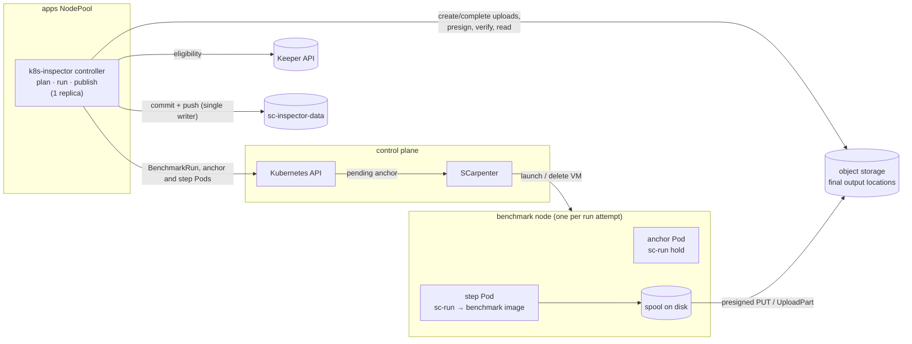

# Overview

k8s-inspector measures cloud instance types ("SKUs") with the Spare Cores benchmark images and publishes the results
to sc-inspector-data. It runs on a Kubernetes cluster where SCarpenter launches a node of any instance type of any
supported vendor when a Pod asks for it.

## Parts

| Part | Role |
|---|---|
| **Controller** (`k8s-inspector serve`) | One Python process. **Plan**: which SKUs need which tasks. **Run**: create and sequence the Pods of each run, classify the outcome. **Publish**: render finished task results into sc-inspector-data and push. |
| **`BenchmarkRun`** | A small custom resource per run. It is the run's lease and its state, and it is what an operator sees in `kubectl get benchmarkruns`. See [state model](state.md). |
| **Anchor Pod** | Pinned to the instance type. Its pending state makes SCarpenter launch the node; while it runs, the node stays. See [run model](run-model.md). |
| **Step Pods** | One per task (or one for the parallel hardware probes), bound to the anchor's node. |
| **`sc-run`** | A static Go binary in every step container: runs the task, enforces its timeout, spools outputs to disk, uploads them to their final object storage keys. See [output pipeline](outputs.md). |
| **SCarpenter** | Owns everything about nodes: offering choice, capacity and quota errors, launch and deletion. |

## One run, end to end

1. **Plan.** The controller finds SKU `oci/VM.Standard.E5.Flex.2-16` with due tasks (or an operator forces it) and
   creates a `BenchmarkRun`. Its name is derived from the SKU, so a second run of the same SKU cannot start.
2. **Provision.** The controller creates the anchor Pod. SCarpenter launches the cheapest matching offering. The
   controller records region, zone, capacity type, price and node timings in the run status.
3. **Steps.** For each step the controller signs upload URLs, creates the step Pod on the node, waits for it to end
   (watch, not poll), confirms that every output is in object storage, writes the task's `status.json`, deletes the
   step Pod (the kubelet can then free its images), and decides the next step (variant after the probe step, GPU
   fallback, vLLM image ladder).
4. **Release.** When all tasks are done and all uploads are confirmed, the controller deletes the anchor. The node is
   empty and SCarpenter removes it.
5. **Publish.** Every few minutes the publisher renders the finished tasks from their final object storage location
   into the sc-inspector-data tree, commits and pushes. Nothing is moved or copied afterwards.

If a spot node is reclaimed mid-run, the finished tasks are already safe; the run continues on a new node with the
remaining tasks ([spot strategy](spot.md)).

## Principles

- **Simplicity first.** One controller process, no database, no workflow engine, no agent or DaemonSet on benchmark
  nodes, no operator framework. The only custom resource is `BenchmarkRun`, with no webhook and no conversion.
- **Kubernetes is the state.** Running work is what the API server says is running ([state model](state.md)); git
  holds results and history only.
- **Results stay compatible.** The sc-inspector-data layout, `meta.json` fields and task hashes are unchanged, so
  sc-crawler needs no change and the switch reruns nothing by itself ([output contract](../reference/output-contract.md),
  [tasks](../reference/tasks.md)).
- **Benchmark conditions match the VM era where it matters**: privileged, host network, no CPU limits, `nice -20`,
  the same images ([node profile](node-profile.md)).
- **One pipeline per vendor.** A vendor is benchmarked either by the legacy sc-inspector or by k8s-inspector, never
  both ([roadmap](../roadmap.md)).
