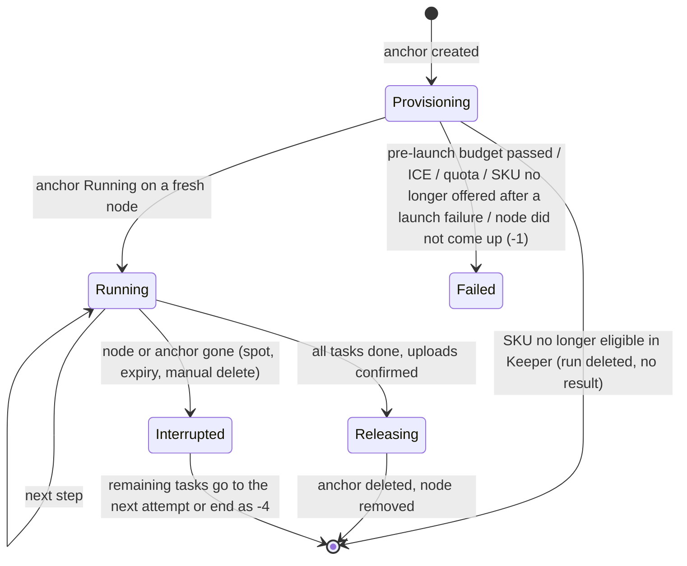

# Run model

**One run attempt = one fresh node = one anchor Pod plus one Pod per step** (decision K1, accepted).

## Why a node per run

A benchmark needs the whole machine and a clean state, so a node is never shared between runs or reused after one.
The bench NodePool has billing retention off, and the controller checks that the anchor's node was created after the
anchor (otherwise it deletes the anchor and that NodeClaim and tries again; the third failed attempt ends the run).
A run that ends or retries because its node did not come up (provisioning failure) or is cancelled deletes its NodeClaims
itself: Karpenter does not consolidate a node that never initialized, so deleting the anchor alone would leave it billing.
A NodeClaim that fails to launch (`LaunchFailed`) is replaced by Karpenter with a new one; the second distinct
launch failure of an attempt ends the run; a temporary one leaves no record, a final one is `-1 SCARPENTER_LAUNCH_REJECTED` ([launch retries](launch-retries.md), [exit codes](../reference/exit-codes.md)).

## Anchor

The anchor is the only Pod the scheduler and SCarpenter ever see for a run.

- `nodeSelector`: `karpenter.sh/nodepool: <benchPool>` (`bench`),
  `scarpenter.sparecores.com/vendor: <vendor>` and `scarpenter.sparecores.com/api-reference: <sku>` (the raw SKU name
  SCarpenter keeps unsanitised, unlike `node.kubernetes.io/instance-type`; with the vendor selector the pair is unique and
  keeps the per-vendor NodeClaim count clear), plus a `karpenter.sh/capacity-type` requirement set by the
  [spot strategy](spot.md). A SKU name that is not a valid label value (over 63 characters, odd characters) cannot be selected
  this way: the run ends `256 HARNESS_ERROR` ("SKU name is not a valid label value; SCarpenter cannot select it by
  api-reference") before any anchor is created. The node's `node.kubernetes.io/instance-type` label is only recorded as a node fact.
- It holds the node: a Running Pod keeps the node non-empty, and `karpenter.sh/do-not-disrupt: "true"` blocks
  consolidation and drift. It does **not** block spot reclaim, `expireAfter` or a manual delete.
- Its container is `sc-run hold`: it first installs the `sc-run` binary into a hostPath directory that the steps
  mount, then sleeps. It exits by itself when no heartbeat has been seen for 45 minutes, so a dead controller
  cannot keep a node (decision K14). The heartbeat is the mtime of the file `heartbeat` in the run's hostPath
  directory (`/var/lib/k8s-inspector/runs/<run_id>`): `sc-run exec` touches it every 10 s while a task runs, and
  `kubectl exec <anchor> -- /sc-run heartbeat <dir>` touches it between steps. The idle clock starts when the anchor
  starts.
- Releasing the node after a successful run = deleting the anchor (or its own exit). A run that is cancelled or fails
  before or while its node is up deletes the run's NodeClaims as well. Terminal Pods do not count, so the node is empty and
  `WhenEmpty`/`consolidateAfter: 0s` removes it. Measured on OCI: the Node is gone 79-91 s after the
  anchor is deleted and the NodeClaim 0-1 s after the Node (see [teardown time](#node-boot-and-teardown)).

## Steps

- Each step is a bare Pod with `spec.nodeName` set to the anchor's node: no scheduler, no SCarpenter involvement. The
  kubelet still admits it on resources and `maxPods`. Step Pods are owned by the anchor, so deleting the anchor
  removes them. The controller deletes a step Pod (and its flush Pods) itself as soon as its tasks' outcomes are in
  `status.tasks` and their `status.json` is written, before the next step starts: the kubelet keeps an image while
  any container uses it, exited ones included, so a finished step's Pod would pin its images against image GC for the
  rest of the run. Only the anchor (the `spec.holdAfter` hold included) lives until the run ends. A reconcile that
  finds no step in flight deletes any step Pod still there, so a Pod the controller did not get to delete is
  collected later; a Pod of a recorded step that is gone changes nothing. The logs and outputs of finished steps are
  in object storage, not on Pods, so `kubectl logs` only works for the step in flight, during a `holdAfter` hold too.
  A step Pod requests the node's CPU minus what the other Pods on the node request, which gives it nearly all the
  cgroup weight in `kubepods.slice` ([CPU weight](node-profile.md#cpu-weight)); if the kubelet refuses that request
  (`OutOfcpu`), the controller creates the Pod once more with `cpu: 10m`.
- A step is one serial task, or the parallel hardware-probe group (dmidecode, lshw, lscpu, lstopo, virtualization,
  nvidia_smi, gpu_facts) as one Pod with several containers. This is today's priority-0 parallel group.
- Before launching a step the controller waits while the node has DiskPressure (see
  [disk pressure](#disk-pressure)), and it deletes the step's tasks' `manifest.json`, `result.json` and `status.json`,
  so `verify` and `finish_task` only see this attempt's files ([outputs](outputs.md)).
- Each step has its own `activeDeadlineSeconds` (pull + version + task timeout + upload + slack), memory limit,
  `hostPID` (storage only) and runtime class (GPU only).
- The controller sequences steps and makes the adaptive decisions that need earlier results: hardware variant after
  the probe step, GPU-first-then-CPU retry, vLLM image ladder, nvbandwidth buffer size (ported from sc-inspector).
- The step in flight (containers, images, commands, GPU runtime) is stored in `status.step` before its Pod is created.
  A restarted controller creates or watches exactly that step; it never plans it again, so a changed catalogue or
  an adaptive decision cannot alter what a Pod already runs.

Pod specs: [Kubernetes objects](../reference/objects.md).

## Memory pressure and shutdown inside a step

`sc-run` shares the task's container cgroup. It sets its own `oom_score_adj` to `-1000` after starting the task,
and the kernel's OOM kill (including the group kill) skips such tasks, so it takes the task and not `sc-run`, which can then still write
`result.json` and the termination message (details and the fallback to the container's `OOMKilled` reason:
[exit codes](../reference/exit-codes.md)).

On SIGTERM (eviction, Pod deletion, spot drain) one deadline counts from the signal: `--grace` (15 s) covers stopping the
task (SIGTERM, SIGKILL after 5 s, also during the version command), the final upload and `manifest.json`, which gets
the last quarter. `result.json` and the termination message are written before the upload starts, and the termination
message is updated afterwards if time allows. Step Pods use `terminationGracePeriodSeconds: 20`. Permanent upload
errors (no URL for a file, a 4xx other than 403, 408 and 429) are not retried: the file is listed as missing in the
manifest. A task that ends killed by SIGTERM counts as cancelled (`cancelled: true`, 143) even when sc-run has not seen the
signal yet: a shutdown signals the whole container at once. `exec` starts with an empty spool, so a rerun never mixes its output with an earlier attempt's.

## Disk pressure

When free disk drops below 1 %, the kubelet sets `DiskPressure=True` for about 5 minutes after the space is free again,
and rejects new Pods even with `spec.nodeName`: phase `Failed`, reason `Evicted`, message
`Pod was rejected: The node had condition: [DiskPressure].` Existing Pods are not evicted
([node profile](node-profile.md#memory-and-disk-behaviour)). The controller therefore:

- launches no step while the node has DiskPressure (the condition or the `disk-pressure` taint), for up to 10 minutes,
  re-checking every 30 s;
- relaunches a step Pod that the kubelet rejected for DiskPressure once, after the pressure clears;
- records the task as `-4` with the rejection message when the Pod is rejected again or the 10 minutes pass.

## Wedged step Pods

The kubelet normally ends a step Pod at its deadline: on an idle node the Pod is `Failed` with reason
`DeadlineExceeded`, and `sc-run` has flushed within its grace ([exit codes](../reference/exit-codes.md)). Under heavy
load the container runtime can lose its shim: the Pod then stayed `Running` for about 10 minutes after the deadline
and `Terminating` for 5.5 minutes after a delete. A Terminating Pod keeps the node non-empty, so the controller runs a
watchdog:

- A step Pod still unfinished at `startTime` + `activeDeadlineSeconds` + `terminationGracePeriodSeconds` + 2 minutes
  is force-deleted (grace 0) when the controller records the step. `finish_task` runs first: if the uploads verify and
  `result.json` exists, its exit code counts (a cancelled one becomes `-4 DEADLINE_EXCEEDED`); otherwise the task is
  `-4 DEADLINE_EXCEEDED`.
- A Pod stuck in `Terminating` more than 2 minutes past its `deletionTimestamp` is force-deleted.

## Step overhead

Every step adds a little idle time on the node between two benchmarks. Its parts:

| Part | Typical | How it is kept small |
|---|---|---|
| Controller notices the previous step ended | ~1 s | a **watch** on the run's Pods wakes the controller; a 15 s poll would add ~7.5 s on average |
| Controller confirms uploads, writes `status.json`, signs URLs for the next step | ~1 s | a handful of object storage calls |
| Pod creation → kubelet sees it | <1 s | `nodeName` skips scheduling |
| Pod sandbox | ~1 s | `hostNetwork: true` needs no CNI setup (the loopback-only tasks get a CNI namespace, a fraction of a second more) |
| Wrapper delivery | 0 s | `sc-run` is installed once per node by the anchor into a hostPath and mounted read-only; no per-step initContainer |
| Container start | <1 s | image pulled by digest with `IfNotPresent` |
| Kubelet reports the end | ~1 s | |

That is about **3-5 seconds per step**, under 2 minutes for a full run of about 20 steps, next to 1-1.5 minutes of
node boot. A naive version (polling every 15 s and an initContainer per step) would cost about 10 s per step, 3-4 minutes
per run.

**Image pulls** are not step overhead: the VM era pulled each image before its task too. Pulls happen between
benchmarks, never during one. Measured pulls from ghcr.io to an OCI Frankfurt node: `sc-run` 2.3 MB in 1.5 s, the
probe images 33-51 MB in 2-3 s, stress-ng and membench 46-59 MB in 3-5 s, `benchmark-llm` 2.08 GB in 139 s. Pre-pulling all of a run's images at node start would only move the time, and it would
fill the disk before `llm` needs it, so it is not planned.

Measured on an idle node with the images cached (a watch on the Pods): Pod create → containers Running 0.9 s;
the watch reports completion about 1.5 s after the task ends; about 4 s per step including the test client's own
latency. Under load (llm running, load 4 on 4 vCPU) create → start took 26 s, so steps never run concurrently with a
benchmark.

Not worth doing: baking `sc-run` into every benchmark image (an sc-images change for every image to save nothing the
hostPath install does not already save), or packing several tasks into one Pod (loses per-task isolation, deadlines
and adaptive decisions; see [alternatives](alternatives.md)).

## Node boot and teardown

Measured on OCI eu-frankfurt-1, on-demand, from NodeClaim creation (Launched +1-2 s):

| Node | Registered | Ready |
|---|---|---|
| A1.Flex.1-2 arm64 | +75-82 s | 88-97 s |
| E5.Flex.1-4 amd64 | +54-65 s | 67-78 s |
| E5.Flex.2-8 amd64 | +46-56 s | 59-68 s |

The anchor is Ready 12-17 s after its node (`sc-run` pull 1.5 s, readiness probe period 2 s, kubelet). Teardown: the
Node is gone 79-91 s after the last non-terminal Pod is deleted and the NodeClaim about 1 s after the Node, so releasing
a node takes about 1.5 minutes.

The anchor itself uses about 3.6 millicores and 8.5 MiB working set (request 1m / 16Mi). The idle timeout fires at the
limit plus 7-8 s (10 s poll): with a 5 minute limit the anchor ended after 5 m 8 s without heartbeat, exit 0, Pod
`Succeeded`.

## Lifecycle of an attempt

A run without a node ends when its SKU stops being possible: SCarpenter no longer offers it after a launch failure
(the failure's reason, [launch retries](launch-retries.md)), or Keeper no longer lists it as ACTIVE or blocks the run's
tasks (the run and its NodeClaims are deleted, no result is recorded; a forced run is not checked). Neither waits for
the pre-launch budget.

A run has one or more attempts. Only the [spot strategy](spot.md) and a failed provisioning (a node older than its
anchor, a vanished anchor) create more than one. An anchor that ends while its node is healthy is a `NODE_LOST` attempt without a spot
record.

A run whose reconciles keep failing for 30 minutes (a time window, not a count: a short API or S3 outage does not
end a run) ends `Failed` with the attempt outcome `HarnessError`: its unfinished tasks are `256` (harness error) and
the status is recorded first. The urls Secret is deleted at that moment; no Pod is: the next pass removes the anchor,
so the SKU lease is released.

An attempt that is lost after every task is done goes to `Publishing` without a retry.

## Teardown layers

| # | Mechanism | Covers |
|---|---|---|
| 1 | Controller deletes the anchor → empty node → `WhenEmpty` | normal path |
| 2 | Step `activeDeadlineSeconds` (kubelet) and the `sc-run` timeout | hung task, stuck upload |
| 3 | Anchor `activeDeadlineSeconds` and the `sc-run hold` idle timeout | dead or stuck controller; enforced on the node |
| 4 | NodePool `expireAfter: 48h` (the longest run, with the 26 h `stressnglongrun`, needs up to ~44 h) + `terminationGracePeriod: 1h` | an anchor held forever |
| 5 | SCarpenter garbage collection of tagged instances without a NodeClaim | controller crash during launch |
| 6 | Alert "bench node running too long" ([monitoring](monitoring.md)) | everything above failed, cluster or SCarpenter bug |

There is no out-of-cluster force-deleter (decision K22): an alert and a human come first.
