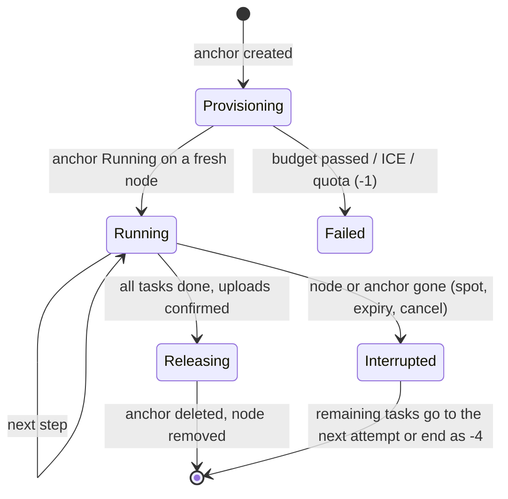

# Run model

**One run attempt = one fresh node = one anchor Pod plus one Pod per step** (decision K1, accepted).

## Why a node per run

A benchmark needs the whole machine and a clean state, so a node is never shared between runs or reused after one.
Bench NodePools have billing retention off, and the controller checks that the anchor's node was created after the
anchor (otherwise it deletes the anchor and that NodeClaim and tries again).

## Anchor

The anchor is the only Pod the scheduler and SCarpenter ever see for a run.

- `nodeSelector`: `karpenter.sh/nodepool: bench-<vendor>[-lowmem|-gpu]` and
  `node.kubernetes.io/instance-type: <vendor>.<sku>`, plus a `karpenter.sh/capacity-type` requirement set by the
  [spot strategy](spot.md).
- It holds the node: a Running Pod keeps the node non-empty, and `karpenter.sh/do-not-disrupt: "true"` blocks
  consolidation and drift. It does **not** block spot reclaim, `expireAfter` or a manual delete.
- Its container is `sc-run hold`: it first installs the `sc-run` binary into a hostPath directory that the steps
  mount, then sleeps. It exits by itself when no step heartbeat has been seen for 45 minutes, so a dead controller
  cannot keep a node (decision K14).
- Releasing the node = deleting the anchor (or its own exit). Terminal Pods do not count, so the node is empty and
  `WhenEmpty`/`consolidateAfter: 0s` removes it. Measured on OCI: about 1 minute to Node removal, 4-8 minutes until the
  NodeClaim is gone.

## Steps

- Each step is a bare Pod with `spec.nodeName` set to the anchor's node: no scheduler, no SCarpenter involvement. The
  kubelet still admits it on resources and `maxPods`. Step Pods are owned by the anchor, so deleting the anchor
  removes them.
- A step is one serial task, or the parallel hardware-probe group (dmidecode, lshw, lscpu, lstopo, virtualization,
  nvidia_smi, gpu_facts) as one Pod with several containers. This is today's priority-0 parallel group.
- Each step has its own `activeDeadlineSeconds` (pull + version + task timeout + upload + slack), memory limit,
  `hostPID` (storage only) and runtime class (GPU only).
- The controller sequences steps and makes the adaptive decisions that need earlier results: hardware variant after
  the probe step, GPU-first-then-CPU retry, vLLM image ladder, nvbandwidth buffer size (ported from sc-inspector).

Pod specs: [Kubernetes objects](../reference/objects.md).

## Step overhead

Every step adds a little idle time on the node between two benchmarks. Its parts:

| Part | Typical | How it is kept small |
|---|---|---|
| Controller notices the previous step ended | ~1 s | a **watch** on the run's Pods wakes the controller; a 15 s poll would add ~7.5 s on average |
| Controller confirms uploads, writes `status.json`, signs URLs for the next step | ~1 s | a handful of object storage calls |
| Pod creation → kubelet sees it | <1 s | `nodeName` skips scheduling |
| Pod sandbox | ~1 s | `hostNetwork: true` needs no CNI setup |
| Wrapper delivery | 0 s | `sc-run` is installed once per node by the anchor into a hostPath and mounted read-only; no per-step initContainer |
| Container start | <1 s | image pulled by digest with `IfNotPresent` |
| Kubelet reports the end | ~1 s | |

That is about **3-5 seconds per step**, under 2 minutes for a full run of about 20 steps, next to 2-3 minutes of node
boot. A naive version (polling every 15 s and an initContainer per step) would cost about 10 s per step, 3-4 minutes
per run.

**Image pulls** are not step overhead: the VM era pulled each image before its task too. Pulls happen between
benchmarks, never during one. Pre-pulling all of a run's images at node start would only move the time, and it would
fill the disk before `llm` needs it, so it is not planned.

Not worth doing: baking `sc-run` into every benchmark image (an sc-images change for every image to save nothing the
hostPath install does not already save), or packing several tasks into one Pod (loses per-task isolation, deadlines
and adaptive decisions; see [alternatives](alternatives.md)).

## Lifecycle of an attempt

A run has one or more attempts. Only the [spot strategy](spot.md) and node loss create more than one.

## Teardown layers

| # | Mechanism | Covers |
|---|---|---|
| 1 | Controller deletes the anchor → empty node → `WhenEmpty` | normal path |
| 2 | Step `activeDeadlineSeconds` (kubelet) and the `sc-run` timeout | hung task, stuck upload |
| 3 | Anchor `activeDeadlineSeconds` and the `sc-run hold` idle timeout | dead or stuck controller; enforced on the node |
| 4 | Controller: bench NodeClaims without an anchor for 30 min → delete | controller-level leaks |
| 5 | NodePool `expireAfter: 48h` (the longest run, with the 26 h `stressnglongrun`, needs up to ~44 h) + `terminationGracePeriod: 1h` | an anchor held forever |
| 6 | SCarpenter garbage collection of tagged instances without a NodeClaim | controller crash during launch |
| 7 | Alert "bench node running too long" ([monitoring](monitoring.md)) | everything above failed, cluster or SCarpenter bug |

There is no out-of-cluster force-deleter (decision K22): an alert and a human come first.
